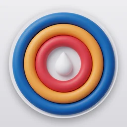

import Head from '@docusaurus/Head';
import Link from '@docusaurus/Link';
import React from 'react';
import clsx from 'clsx';
import SharedZoomImage from '/src/components/ZoomImage.jsx';
import { Email } from '/src/components/Email.jsx';
import styles from './styles.module.css';

{/* The release these screenshots belong to, appended to every screenshot URL
    below. Docusaurus copies `static/` verbatim, so a re-export under the same
    file name would keep serving the old picture from CDNs; bumping this with
    the app's version makes every screenshot a new URL. The images come from
    Resources/AppStore/web.py in the Soar repo (codename Sweat). */}
export const ASSETS = '1.0.0';

{/* Empty until the app is live: the hero shows "Coming soon" in place of
    the App Store badge. Set it to the app's apps.apple.com URL at launch. */}
export const APP_STORE_URL = '';

{/* The shared screenshot viewer (src/components/ZoomImage.jsx), with this
    page's ASSETS version for screenshots that have no responsive copies. */}
export const ZoomImage = (props) => <SharedZoomImage version={ASSETS} {...props} />;

<Head>
  <link rel="canonical" href="https://mateuszdabrowski.pl/soar/" />
  <meta property="og:url" content="https://mateuszdabrowski.pl/soar/" />
  <meta property="og:type" content="website" />
  <meta property="og:title" content="Soar - Easy Bodyweight Workouts" />
  <meta property="og:description" content="Bodyweight workouts planned for you on iPhone and Apple Watch. Pick your exercises and do the sets Soar shows." />
  <meta property="og:image" content="https://mateuszdabrowski.pl/img/og/og-image-soar.png" />
  <meta name="twitter:image" content="https://mateuszdabrowski.pl/img/og/og-image-soar.png" />
</Head>

{/* Hero section */}
<header className={styles.hero} style={{ borderRadius: '44px', marginTop: '1rem', marginBottom: '2rem' }}>
  

    

      

      <h1 className={styles.heroProjectTagline} style={{marginBottom: '0.5rem'}}>Soar</h1>

      
Just start

      
Soar is for everyone who keeps meaning to start training and never does. Pick the bodyweight exercises you want, and Soar plans every workout for you: which exercises today, how many sets and how many reps. Open the app, do the sets it shows and log them. Every two weeks a test of each exercise shows how far you have come, and Soar plans the next two weeks from your result, so the plan grows with you. I built it to be the easiest plan to keep following.

      {APP_STORE_URL ? (
        

          
        

      ) : (
        
Coming soon to the App Store

      )}
      
One purchase. No subscription, ever.

      
iPhone · Apple Watch  Requires iOS / watchOS 26 or later

    

  

</header>

{/* Main Device Showcase */}
{/* The day, a set and the levels: the app as itself, no caption. */}
<section className={styles.section}>
  

    

      <ZoomImage
        priority
        src="/img/apple/soar/Soar-iPhone-Today.webp"
        alt="Soar's Today screen - a push-up re-test, four exercises with their sets and squats already done"
        imgStyle={{maxWidth: '30%', borderRadius: '14% / 6.5%', boxShadow: 'var(--ifm-global-shadow-md)'}}
      />
      <ZoomImage
        src="/img/apple/soar/Soar-iPhone-Workout.webp"
        alt="A dips workout in Soar - two sets logged and the rest timer counting down to the third"
        imgStyle={{maxWidth: '30%', borderRadius: '14% / 6.5%', boxShadow: 'var(--ifm-global-shadow-md)'}}
      />
      <ZoomImage
        src="/img/apple/soar/Soar-iPhone-Progress.webp"
        alt="Soar's Progress screen - the level and medals of each exercise"
        imgStyle={{maxWidth: '30%', borderRadius: '14% / 6.5%', boxShadow: 'var(--ifm-global-shadow-md)'}}
      />
    

  

</section>

{/* Why Soar */}
<section className={styles.section}>
  

    

## Why Soar

    

    
You work out. Soar works out the plan.

    

      

        
› Six exercises to pick from: push-ups, pull-ups, dips, squats, lunges and plank  › The 3-Day Push trains everything in three sessions a week, and Daily Micro-Workouts in six shorter ones  › Each workout asks a little more than the last, and one with a missed set comes back unchanged  › The last set is an AMRAP, as many reps as possible, and reaching the next level on it moves you up on the spot  › Every two weeks a workout becomes a one-set test, and your result plans the next two weeks  › Can't do a push-up, pull-up or dip yet? Start on knee push-ups, inverted rows or bench dips

      

      

        
› Nine levels for every exercise, from Starter to Hero, and four medals on the way  › A chart of your tests and AMRAP sets, and a calendar of every training day with your streak  › Injured or sick? Pause the day or a single exercise, and the plan waits for you  › A daily reminder at the time you train, quiet on rest days  › Apple Watch: today's workout on your wrist, with a rep counter, a rest timer and a plank timer  › Workouts saved to Apple Health, if you want them there  › Synced through your own iCloud - no account to create, no server of mine

      

    

  

</section>

{/* What's inside Header */}

  

## What's inside

  

{/* Feature 1: Today */}
<section className={styles.section}>
  

    

      

        <ZoomImage
          src="/img/apple/soar/Soar-iPhone-Today.webp"
          alt="Soar's Today screen - tests first, then pending exercises, then completed ones"
          imgStyle={{maxWidth: '100%', maxHeight: '480px', borderRadius: '14% / 6.5%', boxShadow: 'var(--ifm-global-shadow-md)'}}
        />
      

      

### Every Workout, Planned for You

      
Soar opens on Today, with the exercises for the day and the sets and reps of each. Tap one and do what it shows, because the planning is already done. You choose your exercises and your schedule once, during setup, where Soar suggests the schedule that fits your picks, and you can change both later. On a rest day, Today says so and tells you when the next training day is.

      

    

  

</section>

{/* Feature 2: The workout */}
<section className={styles.section}>
  

    

      

        <ZoomImage
          src="/img/apple/soar/Soar-iPhone-Workout.webp"
          alt="A dips workout in Soar - two sets logged, the rest timer running and three sets to go"
          imgStyle={{maxWidth: '100%', maxHeight: '480px', borderRadius: '14% / 6.5%', boxShadow: 'var(--ifm-global-shadow-md)'}}
        />
      

      

### Just Follow the Numbers

      
Each set shows how many reps to do, or how many seconds to hold the plank. Do them, tap Log, and a 90-second rest timer counts down to the next set. Miss a set, and Soar repeats that workout next time, so you move on only once you have hit every set.

      
The last set is different. It is an AMRAP, short for as many reps as possible, so its number is your minimum and you keep going for as long as your form holds. Why? Because your plan comes from your last test, while the AMRAP shows what you can do today. On a good day it gets you more training out of the same workout, and Progress charts it beside your tests. Reach the next level on it with every other set done, and Soar moves you up on the spot, without waiting for the next test. The set shows you the number that gets you there.

      

    

  

</section>

{/* Feature 3: Tests */}
<section className={styles.section}>
  

    

      

        <ZoomImage
          src="/img/apple/soar/Soar-iPhone-Result.webp"
          alt="A push-up re-test result in Soar - 30 reps, up to the Advanced level"
          imgStyle={{maxWidth: '100%', maxHeight: '480px', borderRadius: '14% / 6.5%', boxShadow: 'var(--ifm-global-shadow-md)'}}
        />
      

      

### A Plan That Grows With You

      
Your first workout of each exercise is a test: one set of as many good reps as you can do, or the longest plank you can hold. Soar plans the next two weeks from that number, and each workout in them asks for a bit more than the one before. Then the exercise comes up as a test again, and the next two weeks start from your new result. So the plan keeps up with you whether you improve fast, slowly or not at all, and any starting point works. If you can't do a single push-up, pull-up or dip yet, Soar offers knee push-ups, inverted rows or bench dips instead. Once you can do 15 of them, Soar tests you on the full exercise, and a single good rep there moves you over to it.

      

    

  

</section>

{/* Feature 4: Pause */}
<section className={styles.section}>
  

    

      

        <ZoomImage
          src="/img/apple/soar/Soar-iPhone-Pause.webp"
          alt="Soar's Today screen with the day paused"
          imgStyle={{maxWidth: '100%', maxHeight: '480px', borderRadius: '14% / 6.5%', boxShadow: 'var(--ifm-global-shadow-md)'}}
        />
      

      

### Injured? Sick? Rest First

      
When you are ill or something hurts, you should rest, and Soar lets you do it without losing your place. Tap "Injured? Sick? Pause today" at the top of Today and choose what to pause: everything when you have the flu, or only the push-ups when your wrist hurts. A paused exercise counts as neither a hit nor a miss, a day you pause completely does not break your streak, and when you come back the plan carries on from your last real session. Miss a few days without pausing and Soar adjusts too: four days after your last session it repeats that workout, and eight days after it steps back three workouts.

      

    

  

</section>

{/* Feature 5: Levels and history */}
<section className={styles.section}>
  

    

      

### See Where You Are

      

      
Each exercise has nine levels, from Starter to Hero, and four medals on the way: Bronze, Silver, Gold and Platinum. They show where you stand and how many reps or seconds the next level takes. Progress lists every exercise with its level. Open one to see its ladder, with the date you reached each level, and a chart of your tests and AMRAP sets. The calendar marks every training day and keeps your streak for the month.

    

    

      

        <ZoomImage
          src="/img/apple/soar/Soar-iPhone-Detail.webp"
          alt="The push-up ladder in Soar - nine levels, the current one highlighted, with medals and dates"
          imgStyle={{maxWidth: '30%', borderRadius: '14% / 6.5%', boxShadow: 'var(--ifm-global-shadow-md)'}}
        />
        <ZoomImage
          src="/img/apple/soar/Soar-iPhone-Chart.webp"
          alt="A squat chart in Soar - every test over the last quarter"
          imgStyle={{maxWidth: '30%', borderRadius: '14% / 6.5%', boxShadow: 'var(--ifm-global-shadow-md)'}}
        />
        <ZoomImage
          src="/img/apple/soar/Soar-iPhone-Calendar.webp"
          alt="Soar's calendar - training days for the month and the streak"
          imgStyle={{maxWidth: '30%', borderRadius: '14% / 6.5%', boxShadow: 'var(--ifm-global-shadow-md)'}}
        />
      

    

  

</section>

{/* Feature 6: Apple Watch */}
<section className={styles.section}>
  

    

      

        

          

            <ZoomImage
              src="/img/apple/soar/Soar-Watch-Today.webp"
              alt="Soar on Apple Watch - today's tests and exercises"
              imgStyle={{maxWidth: '100%', borderRadius: '28px', boxShadow: 'var(--ifm-global-shadow-md)'}}
            />
          

          

            <ZoomImage
              src="/img/apple/soar/Soar-Watch-Set.webp"
              alt="Soar on Apple Watch - logging a set of 17 lunges"
              imgStyle={{maxWidth: '100%', borderRadius: '28px', boxShadow: 'var(--ifm-global-shadow-md)'}}
            />
          

          

            <ZoomImage
              src="/img/apple/soar/Soar-Watch-Rest.webp"
              alt="Soar on Apple Watch - the rest timer after the first set"
              imgStyle={{maxWidth: '100%', borderRadius: '28px', boxShadow: 'var(--ifm-global-shadow-md)'}}
            />
          

          

            <ZoomImage
              src="/img/apple/soar/Soar-Watch-Plank.webp"
              alt="Soar on Apple Watch - a plank hold at 28 of 37 seconds"
              imgStyle={{maxWidth: '100%', borderRadius: '28px', boxShadow: 'var(--ifm-global-shadow-md)'}}
            />
          

        

      

      

### On Apple Watch

      
Leave the phone in your pocket. The Watch app shows the same day as your iPhone, and you log each set with the rep counter or the Digital Crown. The rest timer taps your wrist when it is time for the next set, and a complication shows how much of today is done. With Apple Health on, every exercise runs as a workout with your heart rate, counts toward your Activity rings, and keeps the plank timer running with your wrist down.

      

    

  

</section>

{/* Feature 7: Privacy posture */}
<section className={styles.section} style={{ margin: '4rem 0' }}>
  

    

      

        

### Your Training Stays Yours

        

        
Your workouts are stored on your iPhone and Apple Watch and synced through your private iCloud database, which only you can read. There is no Soar server, no analytics, no telemetry, no crash reporting and no third-party code, so nothing about your training reaches me. No account to create, and without iCloud the iPhone app keeps working with everything on the device.

      

      

        

### Apple Health, If You Want It

        

        
Saving to Apple Health is a choice during setup and a switch in Settings. With it on, every exercise you finish becomes a workout in Health with its sets and an estimated calorie count. Soar reads your body weight only to make that estimate, and reads your workouts so it never saves one your Apple Watch already saved. Nothing from Health is copied anywhere else.

      

    

  

</section>

<section className={styles.section}>
  

## Support {#support}

Need help, found a bug, or want to suggest a feature? Email **<Email user="soar_support" />**. Include your iPhone and Apple Watch models and their OS versions - it makes most issues quicker to diagnose. I read every email.

    

### Frequently asked questions

    

  
Is Soar for me?

  If you find starting the hard part, yes. Soar decides what you train each day and how much, so all you do is open the app and follow it. If you already follow a program you like, or want the fastest possible progress, you probably don't need Soar.

  
Which schedule should I pick?

  Both train every exercise three times a week. The 3-Day Push does all of them in one session on three days. Daily Micro-Workouts trains your upper body one day and your legs and core the next, six days a week, so each session is shorter. During setup Soar suggests one from your picks: the 3-Day Push for up to four exercises, and Daily Micro-Workouts for five or six. You can switch in Settings at any time. I use Daily Micro-Workouts myself, for shorter training and to build the habit.

  
Do I need any equipment?

  Push-ups, squats, lunges and plank need only floor space. Pull-ups need a pull-up bar, and dips need parallel bars or the corner of a sturdy worktop. The easier versions work at home too: inverted rows under a kitchen counter or a sturdy bar at hip height, and bench dips on a chair that can't slide. You pick your exercises, so you can leave out anything you have no equipment for.

  
What if I can't do a single push-up or pull-up?

  Then your first test will say so, and Soar offers the easier version: knee push-ups, inverted rows or bench dips. You train on it until a test shows you are strong enough, and the plan moves you up to the full exercise.

  
What happens if I miss a few days?

  If your last session was up to three days ago, the plan carries on as usual. Four to seven days after it, Soar repeats your last workout, and eight to fourteen days after it, Soar steps back three workouts. After two weeks your next session is a test, which sets the numbers from where you are now. If you are ill or injured, pause the day on Today instead, so it counts as neither a hit nor a miss.

  
Can I change my exercises or schedule later?

  Yes. The sliders button at the top of Today adds or pauses exercises, and Settings has the schedule and the day your week starts.

  
Do I need an Apple Watch?

  No. The iPhone app is the whole app. The Watch app is there if you want to train with your phone away: you set Soar up on your iPhone first, and the Watch picks up your plan through iCloud, so both need to be signed in to the same Apple Account.

  
Where is my data stored?

  On your iPhone and Apple Watch, and - if you are signed in to iCloud - in your private iCloud database, synced by Apple's CloudKit. Nothing is stored on any server I control. See the [privacy policy](#privacy-policy) below.

  
Is Soar medical advice?

  No. Soar is a training plan. Stop if something hurts, warm up before a test, and if you are not sure hard exercise is right for you, check with a doctor first. The app tells you the same during setup and before each test.

 

:::note Reporting a bug
**Useful details to include:**
* A short description of what happened.
* What you expected to happen.
* The Soar version and build number (visible at the top of **Settings**).
* Your iPhone and Apple Watch models and their OS versions.
* A screenshot, if relevant.
:::

  

</section>

{/* Visual separator for Privacy Policy */}
<section className={styles.section} style={{ marginBottom: '4rem' }}>
  

## Privacy Policy {#privacy-policy}

Last updated: 2 November 2026

Soar is built by Mateusz Dąbrowski. This policy explains what the Soar app for iPhone and Apple Watch does with your data. It is short because Soar sends nothing to me.

    

### Nothing reaches me

    

I operate no servers for Soar. There is no account to create, no sign-in, and no way for your data to reach me. Soar contains <strong>no analytics, no telemetry, no crash reporting, no advertising identifiers and no third-party SDKs of any kind</strong> - it is built entirely against Apple's own frameworks. Its only network traffic is Apple's iCloud sync, described below.

    

### What Soar stores, and how

    

Your training history and settings are saved on your iPhone and Apple Watch and, if you are signed in to iCloud, in <strong>your private iCloud database</strong> through Apple's CloudKit. It is visible only to you, on devices signed in to your Apple Account. I cannot see it.

<ul>
  <li><strong>Training history</strong>: the exercises you picked, every workout with its sets and reps or seconds, and every test result.</li>
  <li><strong>Settings that sync</strong>: your schedule, the day your week starts, reminder times and whether workouts are saved to Apple Health.</li>
  <li><strong>Device-local settings</strong>, such as the app's appearance and the late-evening reminder, stay on the device that set them.</li>
</ul>

    

### Apple Health

    

Saving to Apple Health is optional. Soar asks during setup, and you can turn it off in Settings or in the Health app at any time. With it on, Soar:

<ul>
  <li><strong>writes</strong> one workout to Health for every exercise you finish, with its sets and an estimated active energy. On Apple Watch the workout also records your heart rate while you train, through Apple's workout session;</li>
  <li><strong>reads</strong> your most recent body weight, only to estimate active energy, and your workouts, only so the iPhone never saves one your Apple Watch already saved.</li>
</ul>

Health data stays in Health. Soar does not copy it into its own storage or iCloud database, never sends it anywhere, and never uses it for advertising or anything other than the workouts described above.

    

### Notifications

    

Reminders are scheduled on your device and never pass through a server. The daily reminder says how many exercises and tests are waiting. The optional late-evening reminder names the exercises still open and your streak. On Apple Watch, a notification tells you when a rest between sets is over. Notification text can appear on your lock screen, depending on your device settings.

    

### Apple Watch

    

The Watch app keeps its own copy of your training and syncs it through the same private iCloud database. It also sends short timing logs to your iPhone over Apple's Watch connection, so you can copy them from Settings when you report a bug. They contain timestamps and timer lengths, no health data, and stay on your devices unless you send them to me yourself.

    

### Data Soar does not collect

    

Soar does <strong>not</strong> collect, transmit or store any of the following: personal information, account credentials, analytics or usage data, crash reports, advertising identifiers, location, contacts or photos. The App Privacy label on the App Store is "Data Not Collected", and this policy is why.

    

### iCloud

    

Sync uses your own iCloud account and Apple's infrastructure, and Apple's privacy policy governs it: <a href="https://www.apple.com/legal/privacy/">apple.com/legal/privacy</a>. Without an iCloud account the iPhone app keeps working with the data on the device and does not sync. You can turn iCloud off for Soar alone in your iPhone's iCloud settings.

    

### Deleting your data

    

Deleting the app removes its data from that device. What is in iCloud can be removed under Settings › Apple Account › iCloud › Manage Storage › Soar. Workouts Soar saved to Apple Health stay in Health until you delete them there: open the Health app, then your profile › Apps › Soar.

    

### Children's privacy

    

Soar is not directed at children and collects no information from anyone, of any age.

    

### Changes to this policy

    

If the policy changes, I'll update the "Last updated" date above and post the new version at the same URL. Material changes will be called out in the app's release notes.

    

### Contact

    

Questions about this policy or about Soar's data handling: **<Email user="soar_support" />**.

  

</section>
